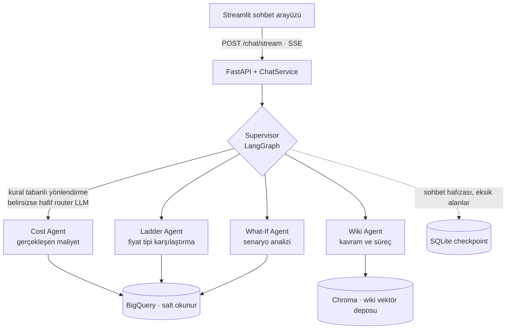

# CostLens — Maliyet İçgörü Asistanı · Vaka Çalışması

> Perakende sektöründe yaptığım staj kapsamında geliştirdiğim çok ajanlı yapay zekâ asistanının vaka çalışmasıdır.
> **Kaynak kod ve veriler şirket içi olduğu için bu repoda paylaşılmamıştır.** Bu doküman problemi, ürün kararlarını ve mimariyi anlatır.

**Rolüm:** Projeyi uçtan uca tasarlayıp geliştiren stajyer · **Süre:** Temmuz – Eylül 2026
**Teknolojiler:** Python, FastAPI, LangGraph / LangChain, Streamlit, Google BigQuery, Azure OpenAI, Chroma, SQLite, Pydantic, Pytest

---

## 1. Problem

Maliyet, planlama ve tahsis ekipleri gün içinde dört farklı türde soru soruyor:

| Soru türü | Örnek | Bugünkü durum |
|---|---|---|
| Sayısal | "Bu siparişin, bu ülke ve dönemdeki gerçekleşen maliyeti nedir?" | Doğru tabloyu, dönemi ve fiyat tipini bilen birinin SQL yazması gerekiyor |
| Açıklama | "Bu maliyet hangi formülle, hangi kaynaktan geldi?" | Bilgi, dokümanlar ve uzman kişiler arasında dağınık |
| Kavram | "Bu iki fiyat tipinin farkı nedir?" | Kurum içi wiki veya eğitim gerekiyor |
| Karar | "Navlun oranı değişirse brüt kâr ne olur?" | Elle senaryo hesabı veya yeni rapor talebi |

Bu soruların bir kısmı **aynı kelimeleri** kullanıyor ama farklı niyet taşıyor. Örneğin bir fiyat tipi sorusu, sipariş numarası yoksa kavram sorusu, varsa veri sorusu oluyor. Tek bir "her şeyi bilen" asistan bu belirsizlikte kırılıyor.

## 2. Ürünün vaadi

- SQL yazmadan doğru kırılıma inmek
- Her sayıyı **kaynağı ve formülüyle birlikte** görmek
- "Şu değişirse ne olur?" sorusunu mevcut veriyi değiştirmeden denemek
- Kavramları kurum içi wiki'den almak; wiki'de yoksa **uydurmamak**
- Aynı konuşmada kısa devam mesajlarını ("ülke TR olsun") bağlama oturtmak

**Bilinçli olarak kapsam dışı bırakılanlar:** veri yazma/güncelleme, kayıt onaylatma, tahmin (forecast) üretme, genel amaçlı sohbet, dışarıya açık SaaS.

## 3. Ürün ilkeleri

Her teknik karar bu ilkelere bağlandı:

1. **Sayı uydurulmaz.** Tüm tutarlar araç çıktısından gelir; model serbest metinle sayı üretemez.
2. **İş kuralı kodda yaşar.** Formüller ve öncelik sıraları Python'da; model yalnızca parametre çıkarır.
3. **Tek ajan, tek araç.** Yetkiler karışınca halüsinasyon da karışır.
4. **Ucuz yol önce.** Selamlaşma ve net niyetler LLM çağrısı olmadan çözülür.
5. **Eksik bilgi tek seferde sorulur.** Kullanıcıya üç ayrı tur yerine tek bir netleştirme sorusu.
6. **Kullanıcıya teknik yüzey yok.** Hata mesajları iş birimi diline çevrilir.
7. **Veri salt okunur.** Parametreli sorgular; senaryo hesapları bellekte yapılır.

## 4. Mimari

Supervisor'ın kendine ait bir veri aracı yok; yalnızca isteği doğru uzmana devrediyor. Her uzman yalnızca kendi aracına erişiyor. Sayılar, formüller ve SQL Python kodunda üretiliyor. LLM'in rolü niyeti anlamak, eksik alanları çıkarmak ve sonucu açıklamakla sınırlı.

## 5. Önemli tasarım kararları

| Karar | Seçilen | Elenen | Gerekçe |
|---|---|---|---|
| Ajan yapısı | Supervisor + 4 uzman | Tek "mega" ajan | Aynı kelimeler farklı niyet taşıyor; ayrı ajan = ayrı prompt, ayrı araç, ayrı test |
| Yönlendirme | Önce kural, belirsizse LLM | Her mesajda LLM / yalnızca regex | Net niyetler ucuz ve tekrarlanabilir; kısa devam mesajları için LLM gerekli |
| Hafıza | Yapılandırılmış slotlar supervisor'da | Her uzmanın kendi belleği | "Model unutkanlığı" ürün hatası olmaktan çıkıyor |
| Maliyet zinciri | Tek araç içinde 4 adım | 4 ayrı LLM araç çağrısı | Adım sırası bir iş kuralı; her araç çağrısı ek gecikme ve maliyet demek |
| Yanıt iletimi | SSE streaming | Tek seferde JSON | İlk token süresi sohbet hissini belirliyor |
| Arayüz / API | Ayrı Streamlit ve FastAPI süreçleri | Tek uygulama | Arayüz değişse de API sözleşmesi korunuyor |

## 6. Kalite ve test

- ~28 test modülü, ~240 test fonksiyonu (Pytest)
- Azure OpenAI ve BigQuery mock'lanarak CI'da kota ve ağ bağımlılığı kaldırıldı
- Yönlendirme için değerlendirme fixture'ları: hangi cümlenin hangi uzmana gitmesi gerektiği
- Uydurma sayıya karşı koruma, kullanıcı dostu hata mesajları ve regresyon testleri

## 7. Sınırlar ve yol haritası

Bilinen sınırlar: API anahtarıyla kimlik doğrulama (satır bazlı yetki yok), wiki'nin sohbet sırasında yeniden indekslenmemesi, sağlık kontrolünün bağımlılıkları ölçmemesi.

Sonraki adımlar için önceliklendirme:
1. Gözlemlenebilirlik: rota, araç, gecikme ve token ölçümü
2. Üretim güvenliği: kimlik sağlayıcı entegrasyonu ve veri erişim yetkileri
3. Gerçek kullanıcı cümleleriyle kalite değerlendirmesi
4. İş KPI'ları: netleştirme sorusu oranı, karar süresi

## 8. Bu projeden öğrendiklerim

- Bir LLM ürününde asıl ürün kararı, **modelin neyi yapmayacağını** belirlemek: sayı üretmemek, veri yazmamak, wiki'de olmayanı uydurmamak.
- Kullanıcı güveni, doğru cevabın yanında **cevabın kaynağını göstermekten** geliyor.
- Kapsamı bilinçli olarak daraltmak (forecast yok, yazma yok) teslim süresini ve güvenilirliği birlikte iyileştirdi.

---

📫 [linkedin.com/in/busra-gumusay](https://linkedin.com/in/busra-gumusay) · [github.com/busragmsy](https://github.com/busragmsy)
